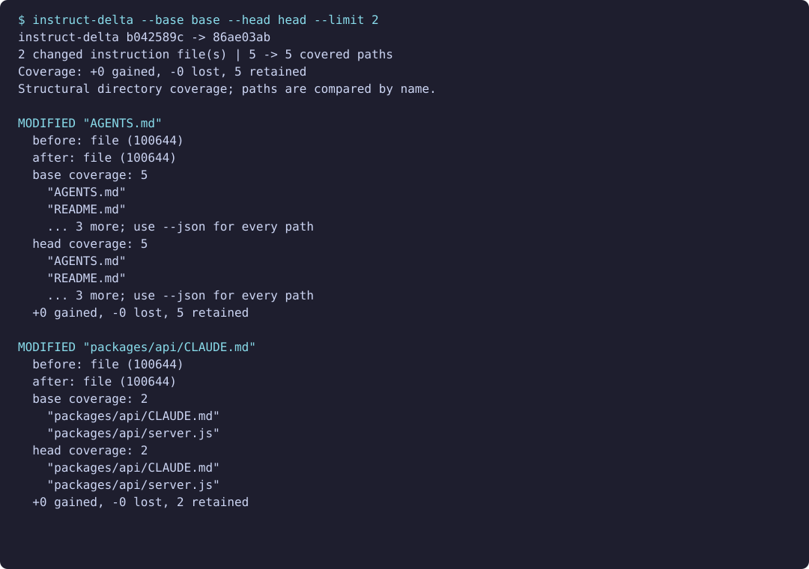

# instruct-delta

See which files an instruction change reaches before merging a pull request.

[](https://github.com/itzjk/instruct-delta/actions/workflows/test.yml)
[](LICENSE)



## Quick start

Install with Node.js 22 or later and Git on your PATH:

```sh
npm i -g github:itzjk/instruct-delta
```

From the repository you are reviewing, compare two commits:

```sh
instruct-delta --base main --head HEAD
```

## Features

- Review the files beneath every added, edited, renamed, or deleted instruction file.
- See coverage gained, lost, and retained across both Git revisions.
- Keep parent coverage visible when instructions are nested in a monorepo.
- Export complete, sorted JSON for CI and review tooling.
- Compare committed history while your checkout contains unfinished work.

## Why

[Claude Code issue #31005](https://github.com/anthropics/claude-code/issues/31005) asks for shared instruction support across coding agents; a GitHub API check on October 28, 2026 recorded 430 thumbs-up reactions. That is demand for interoperability, while the review problem here is narrower: a small instruction edit can reach files across an entire repository.

[agents-md-scope](https://github.com/KanadeK/agents-md-scope) explores a path in one snapshot, [source-agents](https://github.com/iannuttall/source-agents) maintains instruction sourcing, and [ai-rules-sync](https://github.com/PanisHandsome/ai-rules-sync) converts and synchronizes rules. instruct-delta compares coverage in two Git trees, without generating rules or calling a model.

## How it works

The CLI resolves each revision to a commit and tree, finds changes to exact-case `AGENTS.md` and `CLAUDE.md` files, and lists tracked entries beneath each instruction's directory in each tree. A root instruction covers the entire tree, including nested instruction files and the instruction itself. Nested instructions keep their parents' coverage. Git rename detection pairs similar files; every change includes its before and after paths, object IDs, modes, and entry kinds.

Coverage is compared by repository-relative path. A source file moved between directories appears as a lost path and a gained path. “Retained” means the path exists in both coverage sets, even when its contents changed. The summary takes the union across changed instructions, counting overlapping paths once. It describes coverage under changed instructions; losing that coverage does not imply losing all instructions.

## Usage

| Option | Purpose |
| --- | --- |
| `--base <ref>` | Required base commit, branch, or tag |
| `--head <ref>` | Required head commit, branch, or tag |
| `--json` | Full report with `schemaVersion: 1` |
| `--limit <n>` | Visible paths per instruction per tree; default 10 |
| `--help` | Show command help |
| `--version` | Show the installed version |

Human output states how many paths were omitted. `--limit 0` shows counts only. JSON always contains every path, even with `--limit`; see the [report contract](docs/report.md) and [JSON Schema](docs/schema.json).

For pull requests, fetch both revisions first and supply their commit IDs. Comparing the target branch's merge base with the PR head shows the branch's changes. An unchanged instruction set produces an empty report and exit code zero. Invalid arguments, missing history, and unresolved refs produce stderr diagnostics and exit code one. Refs must identify a single commit; option prefixes, ranges, whitespace, and path selectors are rejected.

## FAQ

**Does it change my Git state?** No. It reads committed objects without checking out branches, updating the index, or writing files.

**Does it work from a subdirectory?** Yes. Paths always refer to the repository root. Bare repositories work too.

**Does it show what Claude or Codex actually read?** It reports directory coverage. It does not simulate prompt assembly, precedence, or instruction conflicts.

**Can I install from a clone?** Run `npm i -g .` from the cloned repository. There is no build step or runtime dependency to install separately.

## Limitations

- Only the two exact filenames are recognized. Imports, override files, Cursor rules, and instructions outside the repository are outside scope.
- Symlinks are labeled and never followed. Submodules count as opaque entries; their contents are not inspected.
- Paths must be valid UTF-8. Spaces, Unicode, tabs, and newlines are preserved in JSON and escaped in terminal output.
- Required objects must be available locally. Each Git command has a 256 MiB output ceiling; exceeding it fails explicitly. Reports are held in memory.
- Rename pairing uses Git's 50% similarity heuristic; heavily edited moves may appear as deletion and addition.

## Contributing

Run `npm test` for end-to-end tests using temporary Git repositories; see [the demo instructions](docs/demo.md) to record the example.

## License

[MIT](LICENSE).
